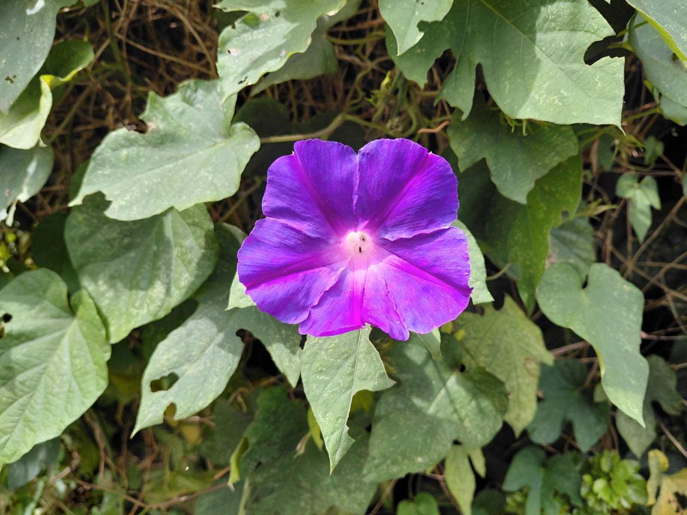
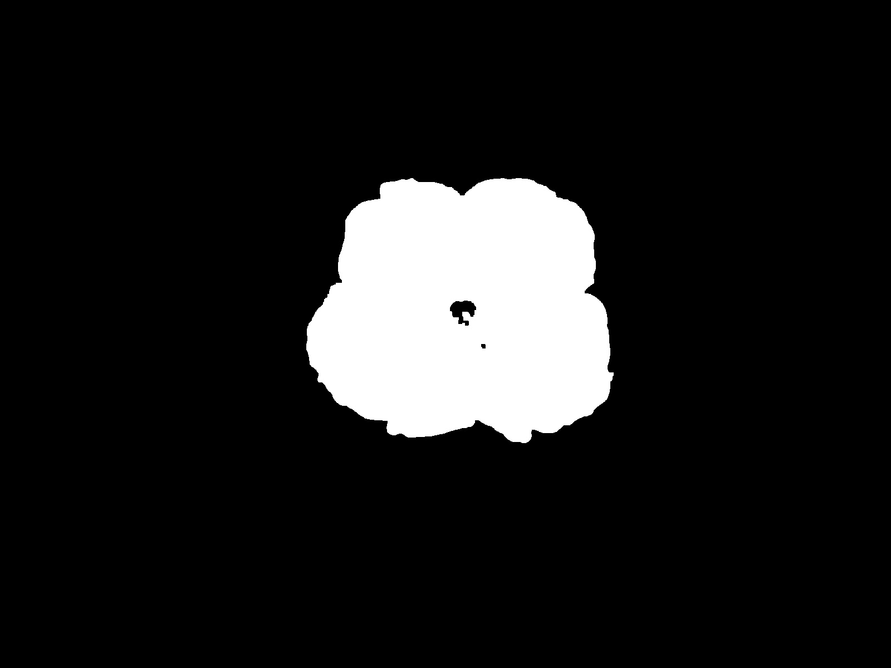
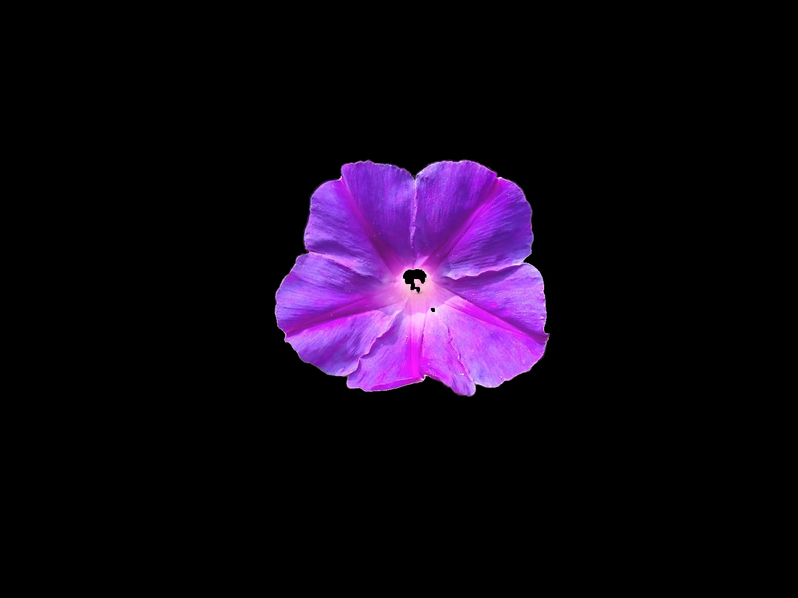
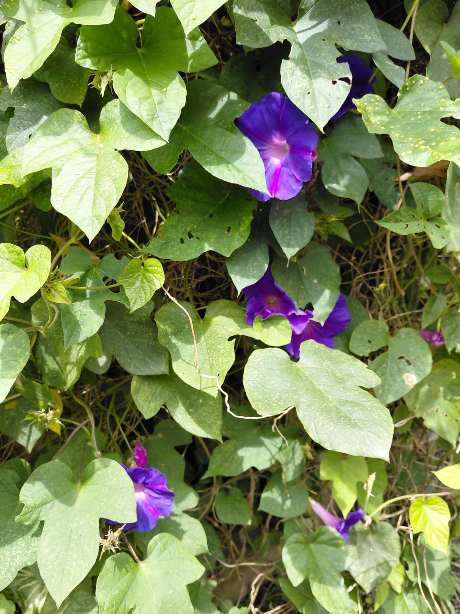
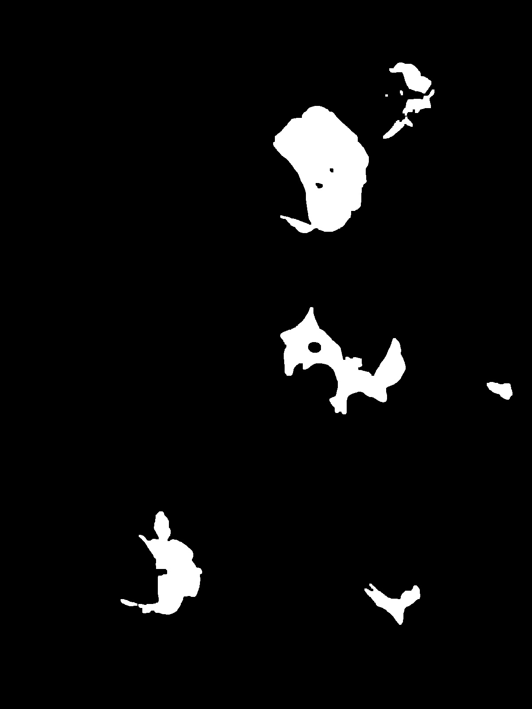
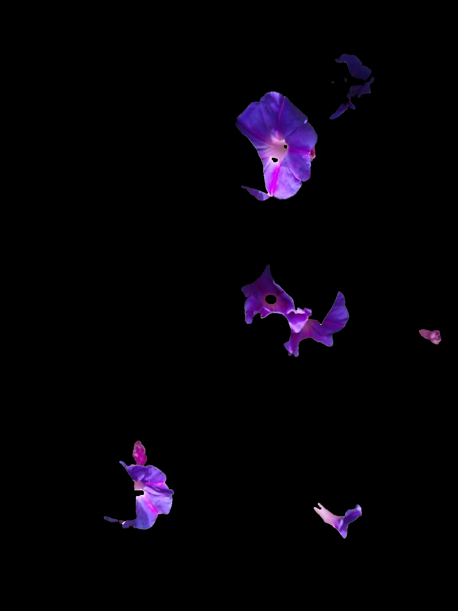
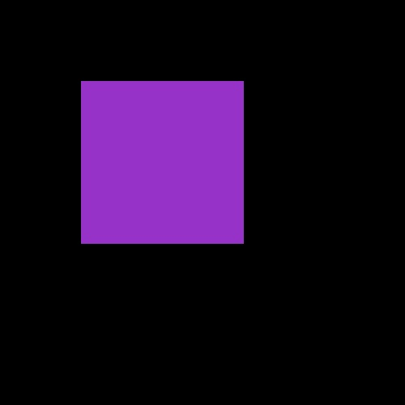

# Processamento de Imagens: Segmentação e Quantificação de Flores 🌸

Este projeto foi desenvolvido para estudar e aplicar técnicas de Processamento Digital de Imagens (PDI) e Visão Computacional. O objetivo é identificar, recortar (segmentar) e calcular a área ocupada por flores roxas/azuis em fotos, usando Python e a biblioteca OpenCV.

## 1. O Método e as Ferramentas Utilizadas

Separar cores usando o padrão normal das imagens (RGB) é complicado, porque a luz do sol e as sombras se misturam com a cor da flor. Para resolver isso, apliquei as seguintes técnicas:

1. **Conversão para HSV (Matiz, Saturação e Brilho):** Mudei o formato da imagem para focar apenas na "Matiz" (a cor pura). Defini um intervalo de cores focado apenas nos tons de azul e roxo.
2. **Máscara Binária (Thresholding):** O código percorre a foto e diz: *"se o pixel for roxo/azul, pinte de branco; se for folha verde ou fundo, pinte de preto"*. 
3. **Operações Morfológicas (Abertura e Fechamento):** Funcionam como uma "vassoura" matemática. Elas limpam pequenos pontinhos brancos perdidos no fundo (ruídos) e tapam buraquinhos pretos que ficaram perdidos no meio da flor branca.

---

## 2. Resultados das Imagens Originais

O algoritmo analisou duas fotos reais. O total de cada imagem é de 1.920.000 pixels.

### Flor 1 (Foco Centralizado)
A máscara identificou a flor muito bem. O miolo dela ficou preto na máscara, o que faz todo o sentido, já que na foto original o miolo é branco/amarelado e o algoritmo estava procurando apenas roxo.

* **Quantidade de pixels da flor:** 206.675 pixels.
* **Percentual de ocupação:** 10,76% da imagem total.

**Visualização:**
| Original | Máscara Gerada | Resultado Final |
| :---: | :---: | :---: |
|  |  |  |

### Flor 2 (Flores entre as folhas)
Essa foto era mais difícil porque as folhas cobrem pedaços das flores. Mesmo assim, o algoritmo conseguiu recortar certinho só as partes roxas que estavam visíveis, removendo todo o fundo verde.

* **Quantidade de pixels da flor:** 90.734 pixels.
* **Percentual de ocupação:** 4,73% da imagem total.

**Visualização:**
| Original | Máscara Gerada | Resultado Final |
| :---: | :---: | :---: |
|  |  |  |

---

## 3. Validação do Algoritmo (Imagem Sintética)

Para ter certeza de que o código estava calculando a área corretamente, criei uma imagem sintética para testar: um quadrado roxo de 200x200 pixels em um fundo preto. Como eu mesma criei, eu sabia o valor real (*Ground Truth*): a área tinha que dar exatamente **40.000 pixels**.

* **Pixels reais (esperados):** 40.000
* **Pixels detectados pelo código:** 40.401
* **Erro Percentual:** 1,00%

**Imagem Sintética Processada:**

### Discussão e Limitações
O erro foi de apenas **1%**, validando que o método é super preciso para contar a área. Essa pequena diferença de 401 pixels a mais acontece por conta do *antialiasing* (quando o computador mistura um pouco os pixels da borda da figura com o fundo para não ficar serrilhado, e o código acaba contando alguns desses pixels).

**Limitação do método:** Como a detecção é feita puramente por cor, se houvesse algum outro objeto roxo no fundo (como uma borboleta roxa ou uma blusa), o código acharia que é uma flor também, pois ele não consegue reconhecer o "formato" das coisas, apenas a pigmentação.